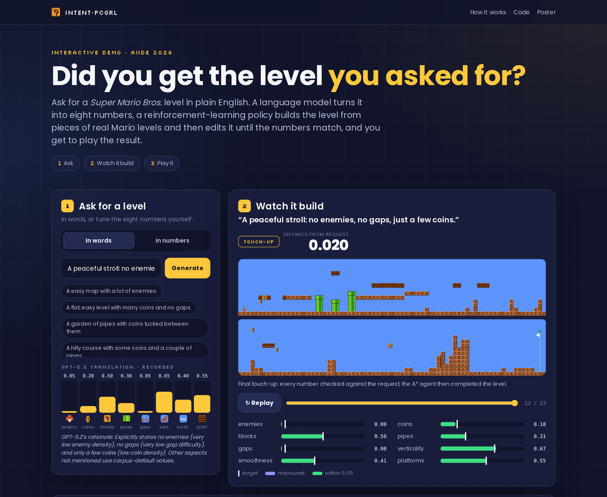
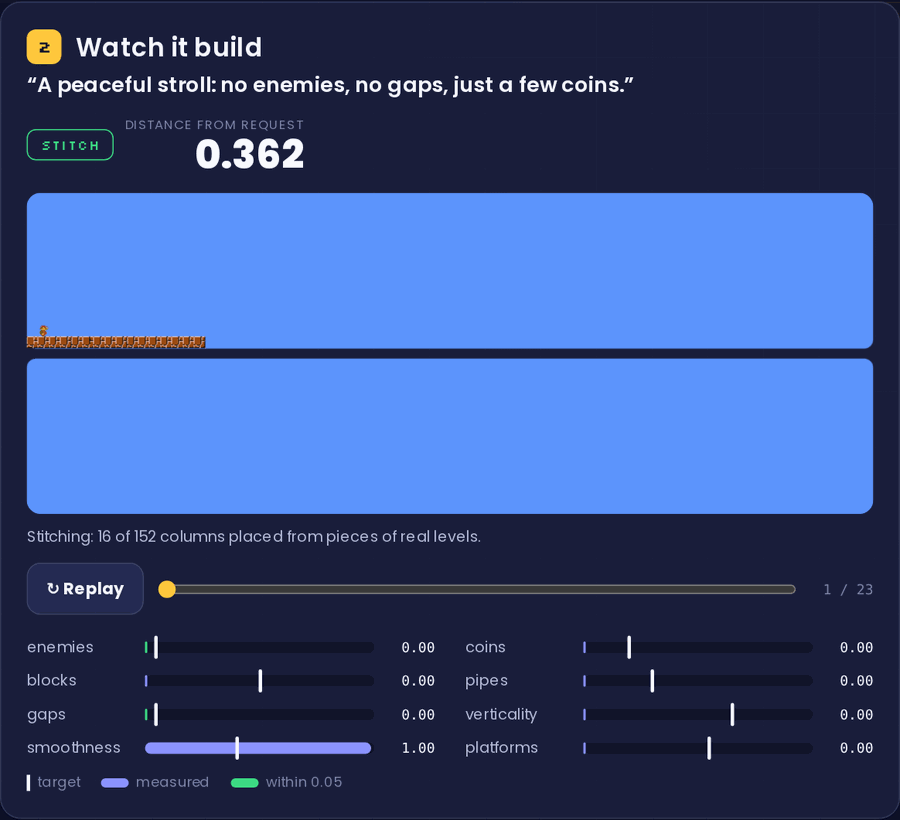
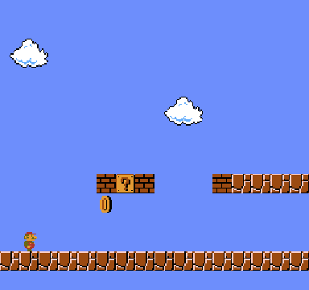

<div align="center">

## Did You Get the Level You Asked For? · Interactive Demo

**Ask for a *Super Mario Bros.* level in plain English, watch a reinforcement-learning policy compose and edit it until it matches the request, then play the result in your browser.**

[](https://github.com/brunolemosdl/intent-pcgrl-demo/stargazers)
[](https://github.com/brunolemosdl/intent-pcgrl-demo/network/members)
[](https://github.com/brunolemosdl/intent-pcgrl-demo/issues)
[](https://github.com/brunolemosdl/intent-pcgrl-demo/graphs/contributors)
[](https://github.com/brunolemosdl/intent-pcgrl-demo/commits)

[](https://brunolemosdl.github.io/intent-pcgrl-demo/)
[](#quick-start)
[-334155?style=flat-square)](#quick-start)
[](https://sb3-contrib.readthedocs.io/)
[-6366F1?style=flat-square)](#what-is-real-and-what-is-simulated)
[](https://github.com/amidos2006/Mario-AI-Framework)
[](#how-to-cite)
[](LICENSE)

[Live Demo](#live-demo) • [Walkthrough](#walkthrough) • [What You Can Do](#what-you-can-do) • [Demo Overview](#demo-overview) • [Real vs. Simulated](#what-is-real-and-what-is-simulated) • [How It Works](#how-it-works) • [Quick Start](#quick-start) • [Regenerate the Data](#regenerate-the-data) • [Structure](#repository-structure) • [Citation](#how-to-cite)

</div>

This repository is the public, interactive companion of the **AIIDE 2026** paper:

> **Did You Get the Level You Asked For? Bridging LLMs and PCGRL for Mario Level Generation**
> Bruno Lemos and Luiz Chaimowicz · Universidade Federal de Minas Gerais (UFMG)

The paper turns a natural-language request into a **numeric contract**: an LLM translates the request into eight numbers, and a language-free reinforcement-learning policy builds the level, edits it under validity gates and hands it to an external A\* agent before release. This demo lets anyone try that loop without installing anything. The research code, trained policies and evaluation artifacts live in [**intent-pcgrl**](https://github.com/brunolemosdl/intent-pcgrl).

## Live Demo

<div align="center">
  <a href="https://brunolemosdl.github.io/intent-pcgrl-demo/"></a>

**[brunolemosdl.github.io/intent-pcgrl-demo](https://brunolemosdl.github.io/intent-pcgrl-demo/)** · works on desktop and mobile · links to a level are shareable (`#ask072`)

</div>

## Walkthrough

<table align="center">
  <tr>
    <td width="68%"></td>
    <td width="32%"></td>
  </tr>
  <tr>
    <td align="center"><sub><b>Watch it build.</b> A real episode for “A peaceful stroll: no enemies, no gaps, just a few coins.”, decision by decision, with every target gauge.</sub></td>
    <td align="center"><sub><b>Release gate.</b> The A* agent finishing the same level.</sub></td>
  </tr>
</table>

## What You Can Do

| Step | In the demo | What happens behind it |
| --- | --- | --- |
| **1 · Ask** | Type a request or pick an example; or open **In numbers** and set the eight targets yourself. | GPT-5.2 maps the request to targets in `[0, 1]` for enemies, coins, blocks, pipes, gaps, verticality, smoothness and platforms (recorded translations, with the model's rationale). |
| **2 · Watch it build** | Replay or scrub the episode; the gauges compare each target with what the level measures. | A MaskablePPO policy stitches pieces of real levels, then applies safe edits; a rule-based touch-up fixes what is left. |
| **3 · Play it** | Run, jump and stomp through the level (keyboard or touch, full screen on any device), or watch the A\* agent. | Every published level passed the paper's release gate: completed by the Mario AI Framework A\* agent. |

## Demo Overview

| Component | Implementation |
| --- | --- |
| Levels | **183** levels, generated offline by the released **10M-step** policy: best of up to 64 runs, with or without the final touch-up, whichever is closer to the request |
| Requests | **88** free-text requests (22 handwritten, 66 structured), each with its **recorded GPT-5.2** translation and rationale |
| Number mode | **95** extra target vectors (one-dimension dials, the page presets and random points) for the **In numbers** tab |
| Release gate | Mario AI Framework A\* agent: at least one win in 3 runs and mean completion ≥ 0.95; failing levels are not published |
| Quality bar | Only levels that match their request are shown: mean error ≤ 0.05, no number off by more than 0.15, and a “none” request (a count target ≤ 0.05) has no enemy, coin or pipe left: the touch-up treats it as zero |
| Accuracy | Mean distance from the request **0.018** (median **0.017**) between requested and measured vectors |
| Episode replay | Every accepted decision with its tile grid, phase, edit operator and measured vector |
| Playable game | Small canvas platformer over the same tile grid: keyboard or on-screen touch controls, full-screen mode, motion shown by squash, stretch and dust |
| Agent recordings | One recorded A\* run per level (animated WebP) |
| Stack | Static HTML, CSS and ES modules; no framework and no build step; self-hosted fonts |

## What Is Real and What Is Simulated

| Real | Simulated by this static page |
| --- | --- |
| Every level was generated by the released policy; the best of several runs is kept. | No model runs in the browser: free text is matched to the closest **recorded** request, and the page says how close the match is. |
| Every published level was completed by the A\* agent, as in the paper. | **In numbers** shows the generated level whose target is closest to your sliders, and reports the distance. |
| Every **In words** request replays a translation recorded from GPT-5.2, exactly as in the paper's record/replay store. | The playable game uses simplified physics, not the original engine. |

## How It Works

- **A · Language bridge.** GPT-5.2 turns the request into eight numbers through a structured-output prompt. It never places a tile, so translation error and generation error are measured separately.
- **B · Stitch.** A MaskablePPO policy stitches about ten of 264 pieces cut from the 15 original *Super Mario Bros.* levels (as converted by the Video Game Level Corpus, VGLC), joined only where Mario can jump across.
- **C · Safe edit.** The same policy applies edits (remove enemies, fill gaps, flatten terrain…). Every edit is checked right away; an edit that breaks the level is undone.
- **D · Touch-up and check.** A simple rule-based touch-up fixes what is left, and the A\* agent must finish the level before release.

Full method, results and limitations are in the [poster](assets/poster.pdf) and the [research repository](https://github.com/brunolemosdl/intent-pcgrl).

## Quick Start

The site is fully static. Serve the repository root and open it:

```bash
python3 -m http.server 8000
```

Then visit <http://localhost:8000>. Any static host works; GitHub Pages serves the `gh-pages` branch.

## Regenerate the Data

The levels and recordings are rebuilt from the research artifact ([intent-pcgrl](https://github.com/brunolemosdl/intent-pcgrl) with its `.venv` and a JDK 17):

```bash
python3 tools/make_jobs.py ~/path/to/intent-pcgrl work/jobs.json
```

```bash
REPO=~/path/to/intent-pcgrl tools/build_data.sh
```

```bash
python3 tools/pack_data.py
```

`make_jobs.py` lists the recorded requests and target vectors; `build_data.sh` rolls the policy, applies polish and the A\* gate and records the agent (resumable, parallel); `pack_data.py` writes `data/` and `gameplay/`, keeping only levels with a winning A\* recording that meet the quality bar.

## Repository Structure

```text
intent-pcgrl-demo/
├── index.html            the demo page
├── assets/
│   ├── app.js            page logic: ask, replay, play, sharing
│   ├── tiles.js          animated level view (tile particles)
│   ├── game.js           simplified platformer
│   ├── match.js          free text → closest recorded request
│   ├── app.css           styles (same visual language as the AIIDE talk)
│   ├── sprites/ fonts/   pixel sprites and self-hosted fonts
│   └── poster.pdf        AIIDE 2026 poster
├── data/
│   ├── index.json        every published level: request, target, measured vector, error
│   └── levels/*.json     per-level episode frames (tile rows, phase, edits, metrics)
├── gameplay/*.webp       recorded A* agent runs
├── media/                README figures
└── tools/                data generation, packing and screenshot scripts
```

## How to Cite

```bibtex
@inproceedings{lemos2026level,
  title     = {Did You Get the Level You Asked For? Bridging {LLMs} and {PCGRL} for Mario Level Generation},
  author    = {Lemos, Bruno and Chaimowicz, Luiz},
  booktitle = {Proceedings of the AAAI Conference on Artificial Intelligence and Interactive Digital Entertainment (AIIDE)},
  year      = {2026}
}
```

## License

Code in this repository is released under the [MIT License](LICENSE). *Super Mario Bros.* tiles and sprites belong to Nintendo and are used for research and educational purposes, as in the Mario AI Framework and the VGLC.
